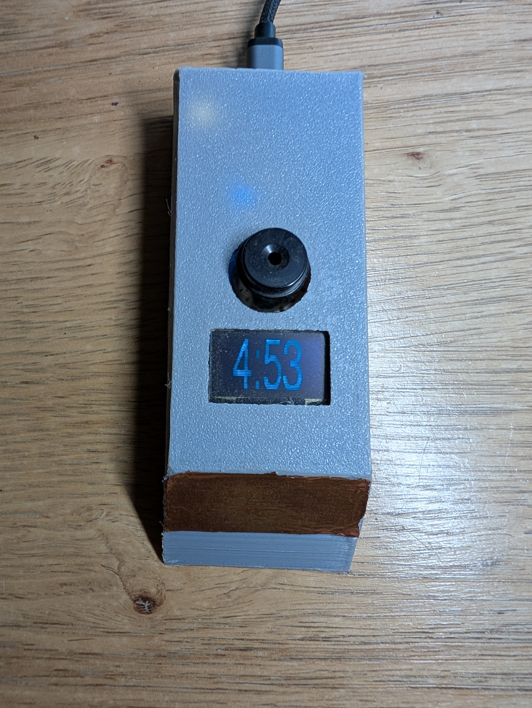
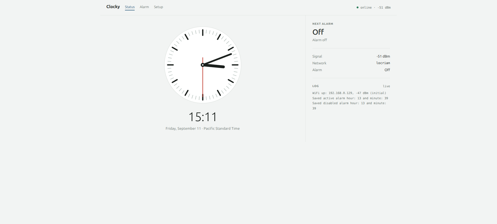
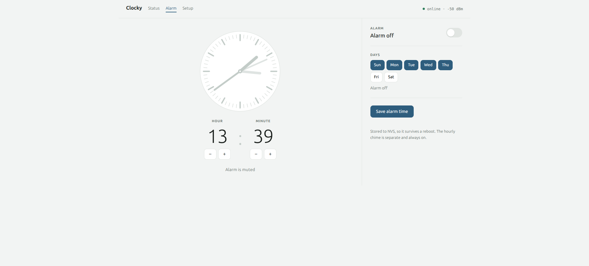
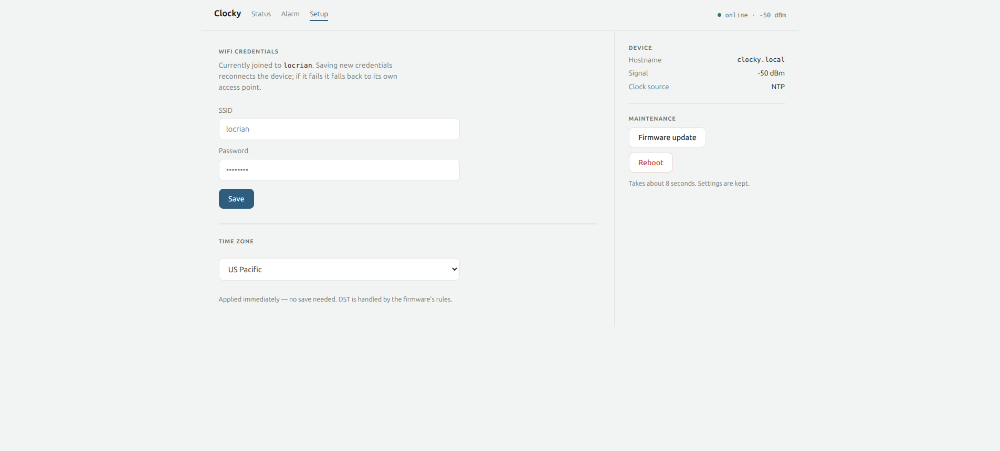

# Clocky

A simple desk clock for the ESP8266 / ESP32 with a web interface for configuration.



## Features

- Synchronizes time over NTP and automatically corrects for daylight saving time.
- Web interface for setting the time zone, alarm, and Wi-Fi credentials.
- Displays day of week, date, month, and 12-hour time.
- Hourly chime and settable alarm via a piezo beeper, with per-day scheduling (e.g. weekdays only) and a "next alarm" readout on the dashboard.
- Sleep mode that suppresses the display light and the hourly chime, toggled with a touch pad. The settable alarm still sounds in sleep mode (that's the point of an alarm) and is silenced with a touch.
- OTA (over-the-air) firmware updates via the web interface.

> [!CAUTION]
> This is a hobby project with no guarantees of reliability. Wi-Fi drops, NTP failures, power outages, and plain old bugs can all cause the alarm to not go off. Don't rely on it for anything you can't afford to be late for — the author is not responsible if it fails and you oversleep.

## Hardware Required

- ESP8266 (e.g. ESP12-F) or ESP32 (e.g. Wemos Lolin32)
- SSD1306 OLED display (128x32)
- Piezo beeper (optional — omit if no chime or alarm is needed)
- A touch pad made from any conductive material (required — see below)

### Wiring

| Component        | Pin |
|-------------------|-----|
| Piezo beeper       | D6  |
| Touch pad sensor   | D7  |
| Touch pad driver   | D3 (through a 300k resistor) |
| Status LED         | D4  |

The touch pad is the only input for switching the clock between desk clock mode and sleep mode, so it is not optional. It works by wiring the conductor directly to input pin D7, and also to output pin D3 through a 300k resistor. Touching the pad adds body capacitance to the circuit, which slows the signal from the driver pin to the sensor pin — this delay is what the firmware detects to register a touch.

Pin assignments and other hardware constants can be changed in [`src/config.h`](src/config.h).

## Building and Flashing

This is a [PlatformIO](https://platformio.org/) project (see [`platformio.ini`](platformio.ini) for the board configuration and library dependencies).

```bash
pio run                       # build
pio run -t upload             # build and flash over serial
pio device monitor            # serial monitor (115200 baud)
```

## Getting Started

1. Flash the firmware as above.
2. On first boot, the clock starts its own access point. Connect to it and open `192.168.4.1` in a browser.
3. Enter your Wi-Fi router's SSID and password to join the clock to your LAN.
4. Once connected, the clock is reachable at `clocky.local` (mDNS) or the IP assigned by your router.
5. Use the web interface to set the time zone, configure the alarm, and perform OTA firmware updates (no serial connection needed after this point).

### Web Dashboard

| Status | Alarm | Setup |
|---|---|---|
|  |  |  |

## Project Structure

```
platformio.ini    Board configuration and library dependencies
src/
  config.h         Hardware constants: pins, display size, tones, touch sensitivity
  Clocky.cpp        Entry point (setup/loop)
  wifi_manager.*     Wi-Fi connection state machine / AP fallback
  time_manager.*      NTP sync and time zone handling
  web_server.*          AsyncWebServer instance, routes, and JSON REST API
  web_assets.*            Embedded HTML/CSS/JS for the web dashboard
  debug.cpp                  Debug log telemetry
```

## Notes

- Confirm the board setting in [`src/config.h`](src/config.h) matches your actual hardware (ESP32 vs. ESP8266) — a mismatch will cause unpredictable behavior.
- The default hostname is `clocky`; this can be changed in [`src/config.h`](src/config.h).

## License

[MIT](src/LICENSE)
